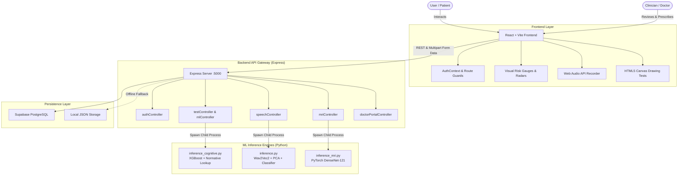

# NeuroLens Architecture Specification

## 1. System Overview

NeuroLens is an integrated, multi-modal cognitive screening and early dementia risk assessment system. The platform orchestrates inputs across three distinct modalities:
1. **Interactive Cognitive Assessments**: Digital MMSE (Mini-Mental State Examination), MoCA (Montreal Cognitive Assessment), Clock Drawing, and Trail Making Tests.
2. **Speech Biomarker Analysis**: Acoustic and linguistic processing using Hugging Face Wav2Vec2 representations, PCA dimensionality reduction, and linear classifiers.
3. **Neuroimaging Classification**: Deep Convolutional Neural Networks (DenseNet-121) analyzing structural MRI scans for atrophy markers.

## 2. Multi-Modal Inference Pipelines

### 2.1 Tabular Cognitive Risk Engine
- **Input**: Age, Education, Sex, Handedness, Raw MMSE/MoCA scores, Domain subscores.
- **Processing**:
  - Demographically adjusted Z-score calculation based on normative lookup tables.
  - Multi-class XGBoost classifier predicting cognitive impairment level (Normal, MCI, Dementia).
- **Execution**: `backend/ml_model/inference_cognitive.py`

### 2.2 Speech Biomarker Engine
- **Input**: Audio recording (`.wav` format) captured from standardized verbal tasks.
- **Processing**:
  - Resampling to 16 kHz mono.
  - Wav2Vec2 base model representation extraction.
  - Temporal pooling and pause/silence ratio calculation.
  - Dimensionality reduction via pre-fitted PCA.
  - Probabilistic classification of acoustic stability.
- **Execution**: `backend/Speech_model/inference.py`

### 2.3 Structural MRI Neuroimaging Engine
- **Input**: Structural brain MRI image (axial/coronal slice in standard JPEG/PNG format).
- **Processing**:
  - Image normalization and center cropping ($224 \times 224$).
  - DenseNet-121 backbone feature extraction.
  - Multi-class atrophy classification (NonDemented, VeryMild, Mild, Moderate).
- **Execution**: `backend/ml_model/inference_mri.py`

## 3. Data Storage and Schema

The application primarily targets **Supabase PostgreSQL** with an automatic fallback to local JSON storage for development environments without database connectivity:
- `users`: Core credentials, roles (`patient`, `doctor`, `admin`), and profile metadata.
- `cognitive_tests`: MMSE, MoCA, Clock, and Trail Making records and scores.
- `speech_analyses`: Audio metadata, Wav2Vec2 metrics, stability percentages, and predictions.
- `mri_scans`: Scan file references, DenseNet class predictions, confidence levels, and prescriptions.
- `doctor_notes`: Clinician observations, verified diagnoses, and longitudinal recommendations.
